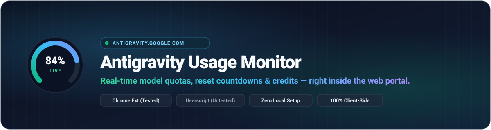
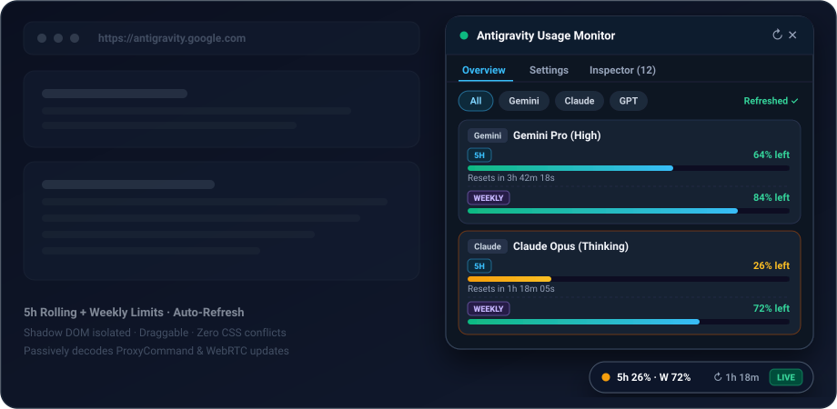
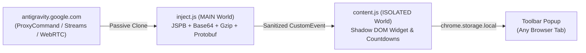

<div align="center">



<br />
<br />

[-10b981?style=for-the-badge&logo=googlechrome&logoColor=white)](#option-1-chrome-extension-recommended--tested)
[](#option-2-greasemonkey--tampermonkey-userscript-untested)
[](#how-it-works)
[](#privacy--security)
[](LICENSE)

<br />

[**Motivation**](#-motivation) · [**Preview**](#-preview) · [**Features**](#-features) · [**Installation**](#-installation) · [**How It Works**](#-how-it-works) · [**Privacy**](#-privacy--security)

</div>

---

## 🎯 Motivation

When coding inside the Google Antigravity IDE or VS Code, community extensions like [`tuckiestudio/antigravity-usage-monitor`](https://github.com/tuckiestudio/antigravity-usage-monitor) make it effortless to keep an eye on model quotas and reset windows. However, those IDE extensions rely on local Node.js process inspection to query the local language server.

The moment you switch to the **`https://antigravity.google.com`** web portal — whether driving your workstation via **Remote Control**, managing **Remote Agents**, or checking in from a Chromebook, laptop, or secondary browser — you lose all live visibility into:

- **How close you are to hitting a rolling rate limit** mid-refactor or mid-deployment.
- **Which model pool still has capacity** (in Antigravity, **Gemini** models and third-party **Claude / GPT** models draw from **separate quota pools** with independent rolling windows).
- **Exactly when your current quota window resets**, down to the second.

**Antigravity Usage Monitor (Web Portal)** solves this natively inside your browser. It brings a sleek, non-intrusive, always-on status pill and interactive dashboard directly into `antigravity.google.com` — with **no local helper daemon**, **no external servers**, and **zero configuration**.

---

## ✨ Preview

<div align="center">
  
</div>

---

## 🚀 Features

| Capability | Details |
| :--- | :--- |
| **Floating Status Pill** | Draggable glassmorphic capsule anchored cleanly on `antigravity.google.com` & `antigravity.google` showing dual `5h` + `Weekly` status (`5h 26% · W 72%`) with persisted position. |
| **Dual Quota Windows (`5h` + `Weekly`)** | Tracks both the short-term **5-hour rolling window** and the overarching **Weekly** cap per model card with separate progress bars and independent countdown timers. |
| **On-Demand & Auto-Refresh** | Click **`↻`** to refresh quotas live without reloading the tab, plus configurable background auto-refresh (default every 60s while the tab is visible). |
| **Color-Coded Health** | Instant visual feedback: **Healthy** (green), **Warning** (amber, default ≥70% used), and **Critical** (pulsing red, default ≥90% used). |
| **Per-Model Breakdown** | Individual progress bars for Gemini, Claude, GPT, and other models with one-click family filter chips. |
| **Live Reset Countdowns** | Real-time 1-second ticking timers showing exact time until each rolling window refreshes (hover for local timestamp). |
| **Prompt Credits Pool** | Tracks available vs. monthly shared credit balance whenever reported by the portal. |
| **Chrome Toolbar Popup** | Syncs your latest live snapshot to `chrome.storage.local` so you can check usage from any browser tab. |
| **Desktop Threshold Alerts** | Optional browser notifications when a model crosses your configured warning or critical threshold. |
| **Trusted Types & Shadow DOM** | 100% pure DOM rendering (zero `innerHTML`) isolated inside a Shadow Root — compliant with Google's strict CSP and immune to page style conflicts. |
| **Built-in Network Inspector** | Deduplicated endpoint diagnostics (headers/tokens are never logged) plus a Live / Mock preview toggle and optional local endpoint poller. |

---

## 📦 Installation

> [!NOTE]
> I personally use the **Chrome Extension**, which has been tested live on `antigravity.google.com`. The **Greasemonkey / Tampermonkey userscript** is generated from the same source as a convenience, but has **not been tested** yet.

### Option 1: Chrome Extension (Recommended & Tested)

1. **Clone or download** this repository:
   ```bash
   git clone https://github.com/vladimiraerov/antigravity-usage-web.git
   ```
2. Open **`chrome://extensions`** in Chrome (or any Chromium-based browser: Edge, Brave, Arc, Vivaldi).
3. Toggle **Developer mode** **ON** in the top-right corner.
4. Click **Load unpacked** and select the [`chrome-extension/`](chrome-extension/) folder.
5. Open **`https://antigravity.google.com`** — the floating Usage Monitor pill appears automatically in the bottom-right corner.

### Option 2: Greasemonkey / Tampermonkey Userscript (Untested)

> [!WARNING]
> This userscript build shares the same code as the Chrome Extension, but has **not** been tested directly in Greasemonkey / Tampermonkey / Violentmonkey. Feedback and PRs are welcome!

1. Install **Greasemonkey**, **Tampermonkey**, or **Violentmonkey** in your browser.
2. Create a new userscript in the extension dashboard.
3. Copy and paste the full contents of [`userscript/antigravity-usage-monitor.user.js`](userscript/antigravity-usage-monitor.user.js) and save (`Ctrl+S` / `Cmd+S`).
4. Reload **`https://antigravity.google.com`**.

---

## ⚙️ How It Works

The Antigravity web portal proxies agent RPCs through Google's Boq endpoints (`ProxyCommand`, `StreamProxyCommand` in `application/json+protobuf` JSPB format) and establishes **WebRTC `RTCDataChannel`** mesh connections. This extension observes those responses **passively and read-only** without adding latency or modifying any traffic:



1. **[`chrome-extension/inject.js`](chrome-extension/inject.js)** (`document_start`, `MAIN` world) — Passively clones and decodes responses across `fetch`, `ReadableStream`, `XMLHttpRequest` (unary + streaming `progress`), `WebSocket`, and `RTCDataChannel`, supporting standard JSON, Google JSPB positional arrays, Base64-encoded `bytes` payloads, gzip frames, Connect-RPC / gRPC-Web envelopes, and binary Protobuf wire format.
2. **[`chrome-extension/content.js`](chrome-extension/content.js)** (`ISOLATED` world) — Mounts a Shadow-DOM isolated, Trusted-Types-safe widget directly onto `document.documentElement` so SPA re-renders never unmount it.
3. **[`chrome-extension/popup.html`](chrome-extension/popup.html) / [`popup.js`](chrome-extension/popup.js)** — Displays the latest synced quota snapshot right from the Chrome toolbar.

---

## 💡 Understanding Quota Pools

If you see **Claude at `100% left`** while **Gemini is lower** (or vice versa), that is expected behavior:

- **Gemini Pool:** Native Gemini models share a single weighted rolling quota pool.
- **Third-Party Pool (Claude / GPT):** Partner models operate on a **separate fixed rate-limit pool** with its own rolling window.
- **Display Metric:** By default, the widget displays **Remaining %** (`100% left` = `0% used`). Open the **Settings** tab inside the widget to switch to **Used %**, adjust thresholds, or enable desktop alerts.

---

## 🔒 Privacy & Security

- **100% Client-Side:** Zero external network requests, zero telemetry, zero analytics, and zero third-party scripts.
- **Minimal Permissions:** The Chrome Extension requests only `storage` and is strictly scoped to `antigravity.google.com` / `antigravity.google`.
- **Zero Credential Logging:** Authorization headers, cookies, session tokens, and prompt contents are never stored or included in Inspector diagnostics.
- **Trusted Types Compliant:** Built exclusively with safe DOM APIs (`createElement`, `textContent`, `replaceChildren`) — zero `innerHTML`.

---

## 📁 Project Structure

```text
antigravity-usage-web/
├── assets/
│   ├── banner.svg                          # README hero graphic
│   └── preview.svg                         # Dashboard UI preview
├── chrome-extension/
│   ├── manifest.json                       # Manifest V3 configuration
│   ├── inject.js                           # Passive network & JSPB/Protobuf decoder
│   ├── content.js                          # Shadow DOM floating pill & dashboard
│   ├── popup.html                          # Extension toolbar popup
│   ├── popup.js                            # Toolbar popup controller
│   └── icons/                              # 16px, 48px, 128px extension icons
├── userscript/
│   └── antigravity-usage-monitor.user.js   # Standalone Tampermonkey/Greasemonkey script
├── LICENSE
└── README.md
```

---

<details>
<summary><strong>🛠️ Troubleshooting &amp; Inspector Diagnostics</strong></summary>

<br />

- **Pill stays in `WAIT` mode:** Interact with a conversation or open the model selector on `antigravity.google.com` so the portal fetches status data.
- **Checking captured endpoints:** Click the pill → open the **Inspector** tab to verify `Network hook: Active` and inspect every unique endpoint observed on the page.
- **Need to test or import a payload manually?** Use the **Test / import a JSON payload** box inside the **Inspector** tab, or click **Copy Diagnostics** to copy a sanitized endpoint summary (no tokens or secrets).
- **Using a local quota bridge?** Open **Settings** and enter your local JSON URL (e.g., `http://127.0.0.1:8484/api/usage`) to poll it alongside portal capture.

</details>

---

## 🙌 Credits & License

- Inspired by [`tuckiestudio/antigravity-usage-monitor`](https://github.com/tuckiestudio/antigravity-usage-monitor) for VS Code / Antigravity IDE.
- Released under the [MIT License](LICENSE).
